<!--
  deeps36 · my little corner of GitHub
  Yes, I still Google regex
  Works on my machine™
  Currently convincing Docker to behave
-->

<!-- ═══════════════════════════════════════
     HERO
═══════════════════════════════════════ -->
<div align="center">

  <a href="https://deepstech.netlify.app/">
    
  </a>

  <h1>
    
    Hey, I'm Deep
  </h1>

  <!-- KEEP EXACTLY — sentimental value -->
  <a href="https://git.io/typing-svg">
    
  </a>

  <p>
    Software engineer with <b>5+ years</b> building scalable web platforms, cloud-native systems, GIS applications and LLM-powered tools:<br/>
    from tools used by <b>Indian state governments</b> to the <b>UK's largest coach network</b>.
  </p>

  <p>
    <a href="https://deepstech.netlify.app/"></a>
    <a href="https://deepstech.netlify.app/resume"></a>
    <a href="https://www.linkedin.com/in/deep-panchal369/"></a>
    <a href="mailto:deep.pd.42000@gmail.com"></a>
  </p>

</div>


<!-- ═══════════════════════════════════════
     PORTFOLIO VIDEO
═══════════════════════════════════════ -->
<h3 align="center">🎬 My portfolio in 34 seconds</h3>

<div align="center">
  <a href="https://deepstech.netlify.app/">
    
  </a>
  <br/>
  <sub>Click it to explore the real thing, and ask the AI on the site anything about my work.</sub>
</div>

<!-- ═══════════════════════════════════════
     ABOUT + NOW
═══════════════════════════════════════ -->
<table width="100%">
  <tr>
    <td width="50%" valign="top">
      <h3>👋 About</h3>
      <p>
        I'm the kind of developer who opens five tabs to understand how something works instead of grabbing the first answer.
      </p>
      <p>
        I like backend systems because they quietly do the heavy lifting, cloud work because <code>localhost → live</code> never gets old,
        and maps because a spatial query that answers a real question on the ground is hard to beat.
      </p>
      <p>
        Favourite bugs? The ones that teach me something.
      </p>
    </td>
    <td width="50%" valign="top">
      <h3>
        
        Right now
      </h3>
      <p>🚌 Engineering the <b>National Express</b> platform at Paul Mason Consultancy</p>
      <p>🏗️ Owning architecture, code reviews, releases and AWS infra end to end</p>
      <p>🤖 Building with LangChain, LangGraph and RAG across Gemini, GPT and Claude, whichever fits the job</p>
      <p>⚡ Pairing with Cursor, Claude Code, Codex and Copilot to go from new requirement to working code fast</p>
      <p>🏅 Star Performer, Dec 2025, for technical leadership and ownership</p>
      <p>☕ Still convincing Docker to behave</p>
    </td>
  </tr>
</table>

<!-- ═══════════════════════════════════════
     IMPACT
═══════════════════════════════════════ -->
## 📈 Impact in numbers

<!-- Each figure is that platform's own number, not a sum dressed up -->

<div align="center">
<table>
  <tr>
    <td align="center" width="25%"><h2>21M+</h2><sub>passenger journeys a year<br/><b>National Express (UK)</b></sub></td>
    <td align="center" width="25%"><h2>50,000+</h2><sub>users reached across India<br/><b>platforms I built</b></sub></td>
    <td align="center" width="25%"><h2>648,000+</h2><sub>hectares mapped<br/><b>Common Land Mapping</b></sub></td>
    <td align="center" width="25%"><h2>27</h2><sub>Indian states<br/><b>GEET</b></sub></td>
  </tr>
  <tr>
    <td align="center"><h2>7</h2><sub>state governments<br/><b>CLART</b></sub></td>
    <td align="center"><h2>50+</h2><sub>forest departments<br/><b>IFMT / VANAPP</b></sub></td>
    <td align="center"><h2>5,000+</h2><sub>farmers in Odisha<br/><b>Agri-MIS</b></sub></td>
    <td align="center"><h2>32,000+</h2><sub>users<br/><b>Common Land Mapping</b></sub></td>
  </tr>
</table>
</div>

<!-- ═══════════════════════════════════════
     JOURNEY
═══════════════════════════════════════ -->
## 🧭 The journey so far

| When | Where | What I did |
| :-- | :-- | :-- |
| **May 2025 – now** | **Paul Mason Consultancy** · Software Engineer | Engineer on the National Express platform: 21M+ journeys, 900+ destinations, 550+ daily services. I lead architecture decisions, code reviews, deployment strategy and engineering standards. `TypeScript` `Node.js` `PostgreSQL` `Docker` `AWS` |
| **Oct 2023 – Apr 2025** | **Re:Invent IT Solutions** (Los Angeles) · Software Developer | Production apps for international clients: scalable APIs, cloud integrations and business-critical features. `React` `Node.js` `PostgreSQL` `AWS` |
| **Apr 2021 – Oct 2023** | **Foundation for Ecological Security** · Developer → Deputy Project Manager | GIS decision-support systems, APIs and reporting engines used by state governments and forest departments, with SSO, multilingual support, dynamic forms and shared microservices. `PostGIS` `GeoServer` `OpenLayers` `Laravel` |

<sub>🎓 MCA, SRM Institute of Science and Technology (9.5/10, 2025) · BCA, Sardar Patel University (8.28/10, 2021)</sub>

<!-- ═══════════════════════════════════════
     FEATURED WORK
═══════════════════════════════════════ -->
## 🚀 Featured work

<!-- One more feature won't hurt -->

<table width="100%">
  <tr>
    <td width="50%" valign="top">
      <h3>🤝 Human API</h3>
      <p>
        Turns messy multi-user team chat into a <b>versioned, executable work contract</b>. Gemini extracts intent; deterministic
        merge, conflict-detection and readiness engines decide what becomes truth. A Jira ticket only ships when the agreement is complete and conflict-free.
      </p>
      <p><code>Gemini</code> · <code>WebSocket</code> · <code>JWT</code> · <code>PostgreSQL</code> · <code>MongoDB</code> · <code>pytest</code></p>
      <a href="https://deepstech.netlify.app/work/human-api"></a>
    </td>
    <td width="50%" valign="top">
      <h3>🗺️ GIS platforms</h3>
      <p>
        Field and geospatial platforms for the Foundation for Ecological Security: <b>Common Land Mapping, CLART, GEET, IFMT/VANAPP, Agri-MIS</b>
        and groundwater monitoring that informed the Jaldoot initiative.
      </p>
      <p><code>PostGIS</code> · <code>GeoServer</code> · <code>OpenLayers</code> · <code>QGIS</code> · <code>Microservices</code></p>
      <a href="https://deepstech.netlify.app/work/gis-platforms"></a>
    </td>
  </tr>
  <tr>
    <td width="50%" valign="top">
      <h3>🧾 Magson ERP</h3>
      <p>
        One system for a shop's inventory, billing, sales, CRM and reporting, instead of five spreadsheets and a prayer. Deployed on AWS.
      </p>
      <p><code>PostgreSQL</code> · <code>Express</code> · <code>React</code> · <code>Node</code> · <code>AWS</code></p>
      <a href="https://deepstech.netlify.app/work/magson-erp"></a>
    </td>
    <td width="50%" valign="top">
      <h3>🐾 PawYard</h3>
      <p>
        A social platform connecting pet owners with service providers: profiles, feeds, notifications and media, behind privacy-preserving APIs.
      </p>
      <p><code>Next.js</code> · <code>GraphQL</code> · <code>MongoDB</code> · <code>AWS</code></p>
      <a href="https://deepstech.netlify.app/work/pawyard"></a>
    </td>
  </tr>
  <tr>
    <td width="50%" valign="top">
      <h3>🩺 FitNat</h3>
      <p>
        Secure health tracking for doctors managing VIP clients: scheduling, messaging and progress tracking in one place.
      </p>
      <p><code>PostgreSQL</code> · <code>Express</code> · <code>React</code> · <code>Node</code></p>
      <a href="https://deepstech.netlify.app/work/fitnat"></a>
    </td>
    <td width="50%" valign="top">
      <h3>💬 Webby</h3>
      <p>
        A MERN chat app I built to stop treating "realtime" like a buzzword: JWT auth, Dicebear avatars, Socket.io messaging.
      </p>
      <p><code>MongoDB</code> · <code>Express</code> · <code>React</code> · <code>Node</code> · <code>Socket.io</code></p>
      <a href="https://github.com/deeps36/webby"></a>
      <a href="https://deepstech.netlify.app/work/webby"></a>
    </td>
  </tr>
</table>

<details>
<summary><b>🧰 More on GitHub</b> · smaller tools and experiments</summary>
<br/>

| Repo | What it is | Stack |
| :-- | :-- | :-- |
| [**parabhakti-api-lambda**](https://github.com/deeps36/parabhakti-api-lambda) | Kitchen ops API (events, menus, push notifications) on AWS Lambda, because servers shouldn't need babysitting at dinner time | `Node` `Express` `MySQL` `AWS` `Firebase` |
| [**Node-Api-Template**](https://github.com/deeps36/Node-Api-Template) | Got tired of scaffolding the same MVC folders, so I made a starter I actually reuse | `Node` `Express` `MVC` |
| [**OAuth-with-node-and-react**](https://github.com/deeps36/OAuth-with-node-and-react) | Auth flows without the mystery, so future-me doesn't relearn OAuth from scratch | `Node` `React` `OAuth` |
| [**hpys2026_infra**](https://github.com/deeps36/hpys2026_infra) | Docker Compose and deploy scripts for Oracle ARM64. Half the work was "why won't this image build" | `Docker` `Shell` `Linux` |
| [**SpringWoods**](https://github.com/deeps36/SpringWoods) | Society management system. Not glamorous, just useful | `PHP` `MySQL` |

</details>

<!-- ═══════════════════════════════════════
     STACK
═══════════════════════════════════════ -->
## 🛠️ Toolbox

<table width="100%">
  <tr>
    <td width="22%"><b>Backend</b></td>
    <td></td>
  </tr>
  <tr>
    <td><b>Frontend</b></td>
    <td></td>
  </tr>
  <tr>
    <td><b>Cloud &amp; DevOps</b></td>
    <td></td>
  </tr>
  <tr>
    <td><b>Data</b></td>
    <td></td>
  </tr>
  <tr>
    <td><b>GIS &amp; maps</b></td>
    <td>
      
      
      
      
      
    </td>
  </tr>
  <tr>
    <td><b>AI &amp; LLMs</b></td>
    <td>
      
      
      
      
      
      
      
    </td>
  </tr>
  <tr>
    <td><b>AI-assisted dev</b></td>
    <td>
      
      
      
      
    </td>
  </tr>
</table>

> **Model-agnostic by habit.** I pick the model by the requirement (cost, latency, context, structured output), so swapping Gemini for GPT or Claude is a change at the edge, not a rewrite. The AI tools speed up the loop; reviews and tests still decide what merges.

<sub>Also in daily use: Git, Postman, Jasper Reports. How I work: system design, database design, API design, code reviews, agile.</sub>

<!-- ═══════════════════════════════════════
     TERMINAL
═══════════════════════════════════════ -->
## 💻 `deep@github:~`

```bash
$ whoami
deep — software engineer · builder · forever learning

$ cat stack.txt
typescript  node  postgres  aws  docker  postgis
langchain  langgraph  rag  gemini  gpt  claude

$ cat copilots.txt
cursor  claude-code  codex  github-copilot

$ cat rules.txt
1. the model extracts intent; deterministic code decides truth
2. if it isn't observable, it isn't done
3. "this should only take an hour" is never true

$ echo $MOTTO
✨ EVER POSITIVE, NEVER NEGATIVE ✨
```

<!-- ═══════════════════════════════════════
     SNAKE
═══════════════════════════════════════ -->
## 🐍 The snake does what the snake does

<!-- Generated by .github/workflows/snake.yml -->

<div align="center">
  <picture>
    <source media="(prefers-color-scheme: dark)" srcset="https://raw.githubusercontent.com/deeps36/deeps36/output/github-contribution-grid-snake-dark.svg" />
    <source media="(prefers-color-scheme: light)" srcset="https://raw.githubusercontent.com/deeps36/deeps36/output/github-contribution-grid-snake.svg" />
    
  </picture>
</div>

<!-- ═══════════════════════════════════════
     CONNECT
═══════════════════════════════════════ -->
## 📬 Let's connect

<!-- If you're reading the source... hi 👋 -->

<p align="center">
  Building something cool? Stuck on something weird?<br/>
  Hit me up. I love that stuff.<br/><br/>
  <sub>Or ask the AI on <a href="https://deepstech.netlify.app/">my portfolio</a>: it answers from my actual work, not marketing gloss.</sub>
</p>

<div align="center">
  <a href="https://deepstech.netlify.app/"></a>
  <a href="https://www.linkedin.com/in/deep-panchal369/"></a>
  <a href="mailto:deep.pd.42000@gmail.com"></a>
  <a href="https://deepstech.netlify.app/resume"></a>
</div>

<br/>

<!-- ═══════════════════════════════════════
     FOOTER
═══════════════════════════════════════ -->
<div align="center">
  
</div>

<p align="center"><sub>thanks for stopping by ✨ · now go build something</sub></p>
